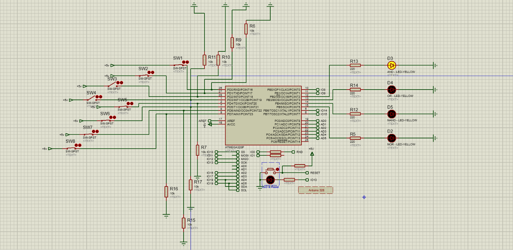

# Switch and LED Interfacing with Arduino Uno Using Proteus

## 1. Project Overview

This project focuses on learning how to interface digital input devices (push-button switches) and output devices (LEDs) with an Arduino Uno.

The project was designed and simulated using Proteus. Eight switches were connected as digital inputs, while four LEDs served as output indicators.

The Arduino was programmed to read the states of the switches and process them using four basic digital logic operations: AND, OR, NAND, and NOR.

This exercise provided practical experience with Arduino digital input/output configuration, logical operators, and controlling electronic components through embedded programming.
## 2. Circuit Design and Components

### 2.1 Components Used

The following components were used to design and simulate the circuit in Proteus:

| Component | Quantity | Description |
|---|---:|---|
| Arduino 328 / ATmega328 | 1 | Main microcontroller |
| Push-button switches | 8 | Digital input devices |
| LEDs | 4 | Visual output indicators |
| 10kΩ resistors | 8 | Pull-down resistors for switch inputs |
| 220Ω resistors | 4 | Current-limiting resistors for LEDs |
| Connecting wires | As required | Electrical connections |

### 2.2 Circuit Architecture

The circuit was divided into four independent sections, each representing a different digital logic gate.

Each section consists of two push-button switches connected to Arduino digital input pins and one LED connected to an Arduino digital output pin.

The Arduino reads the input states, evaluates the corresponding logical condition, and controls the LED based on the result.

The four sections implement:

1. AND gate
2. OR gate
3. NAND gate
4. NOR gate

## 3. Pin Configuration and Connections

The Arduino Uno digital pins were assigned to the switches and LEDs as follows:

| Component | Arduino Pin |
|---|---|
| Switch 1 (AND Input A) | D0 |
| Switch 2 (AND Input B) | D1 |
| AND Gate LED | D10 |
| Switch 3 (OR Input A) | D2 |
| Switch 4 (OR Input B) | D3 |
| OR Gate LED | D11 |
| Switch 5 (NAND Input A) | D4 |
| Switch 6 (NAND Input B) | D5 |
| NAND Gate LED | D12 |
| Switch 7 (NOR Input A) | D6 |
| Switch 8 (NOR Input B) | D7 |
| NOR Gate LED | D13 |

### 3.1 Input Configuration

Each push-button switch was connected to a digital input pin using a 10kΩ pull-down resistor.

- When a switch is released, the input reads `LOW` (0).
- When a switch is pressed, the input reads `HIGH` (1).

The pull-down resistors ensure that the input pins have a defined LOW state when the switches are not pressed.

### 3.2 Output Configuration

Each LED was connected to an Arduino digital output pin through a 220Ω current-limiting resistor.

The Arduino controls each LED according to the logical result of its corresponding gate.

## 4. Arduino Code and Logic Implementation

The Arduino was programmed using the Arduino programming language (C/C++).

The program performs three main operations:

1. Configures the switch pins as digital inputs.
2. Configures the LED pins as digital outputs.
3. Continuously reads the switch states, evaluates the logical conditions, and updates the LEDs.

### 4.1 Logic Implementation

Each pair of switches represents the two inputs of a logic gate.

The program uses the following logical operators:

| Logic Gate | Operator | Output Condition |
|---|---|---|
| AND | `&&` | HIGH when both inputs are HIGH |
| OR | `||` | HIGH when at least one input is HIGH |
| NAND | `&&` with inverted output | LOW when both inputs are HIGH |
| NOR | `||` with inverted output | HIGH when both inputs are LOW |

### 4.2 Source Code

The complete Arduino source code is available in:

`code/logic_gates_sketch/sketch.ino`

The source file is included in this repository for reference and reuse.

## 5. Truth Tables and Expected Results

Each logic gate has two digital inputs, A and B, and one output, Y. The LEDs indicate the output state of each gate.

### 5.1 AND Gate

The AND gate produces a HIGH output only when both inputs are HIGH.

| Input A | Input B | Output Y | LED |
|---:|---:|---:|---|
| 0 | 0 | 0 | OFF |
| 0 | 1 | 0 | OFF |
| 1 | 0 | 0 | OFF |
| 1 | 1 | 1 | ON |

### 5.2 OR Gate

The OR gate produces a HIGH output when at least one input is HIGH.

| Input A | Input B | Output Y | LED |
|---:|---:|---:|---|
| 0 | 0 | 0 | OFF |
| 0 | 1 | 1 | ON |
| 1 | 0 | 1 | ON |
| 1 | 1 | 1 | ON |

### 5.3 NAND Gate

The NAND gate produces the opposite output of an AND gate. Its output is LOW only when both inputs are HIGH.

| Input A | Input B | Output Y | LED |
|---:|---:|---:|---|
| 0 | 0 | 1 | ON |
| 0 | 1 | 1 | ON |
| 1 | 0 | 1 | ON |
| 1 | 1 | 0 | OFF |

### 5.4 NOR Gate

The NOR gate produces the opposite output of an OR gate. Its output is HIGH only when both inputs are LOW.

| Input A | Input B | Output Y | LED |
|---:|---:|---:|---|
| 0 | 0 | 1 | ON |
| 0 | 1 | 0 | OFF |
| 1 | 0 | 0 | OFF |
| 1 | 1 | 0 | OFF |

### 5.5 Observation

The simulation demonstrated the expected behaviour of all four logic gates. The LEDs responded to changes in the switch inputs according to their respective truth tables.

## 6. Simulation and Results

The circuit was simulated using Proteus to verify the operation of the four logic gates.

During the simulation, the push-button switches were used to provide different combinations of digital inputs. The LEDs displayed the corresponding outputs based on the logic implemented in the Arduino program.

### 6.1 Simulation Screenshot

The screenshot below shows the completed circuit during simulation.

### 6.2 Results

All four logic gates (AND, OR, NAND, and NOR) operated as expected during the simulation.

The observed LED states corresponded with the expected outputs in their respective truth tables.

The simulation confirmed that the Arduino could read multiple digital inputs, process logical conditions, and control multiple digital outputs.

## 7. Lessons Learned and Conclusion

### 7.1 Lessons Learned

Through this project, I gained practical experience in:

- Interfacing push-button switches with Arduino digital input pins.
- Configuring Arduino pins as inputs and outputs using `pinMode()`.
- Reading digital input states using `digitalRead()`.
- Controlling LEDs using `digitalWrite()`.
- Applying logical operators such as AND (`&&`) and OR (`||`) in Arduino programming.
- Understanding the behaviour and truth tables of AND, OR, NAND, and NOR gates.
- Using Proteus to design and simulate electronic circuits.

### 7.2 Conclusion

This project provided practical experience in interfacing digital input and output components with an Arduino Uno.

By implementing four basic logic gates, I explored how input signals are processed using logical conditions and translated into physical output states.

The project strengthened my understanding of digital electronics, basic embedded programming, and circuit simulation.
